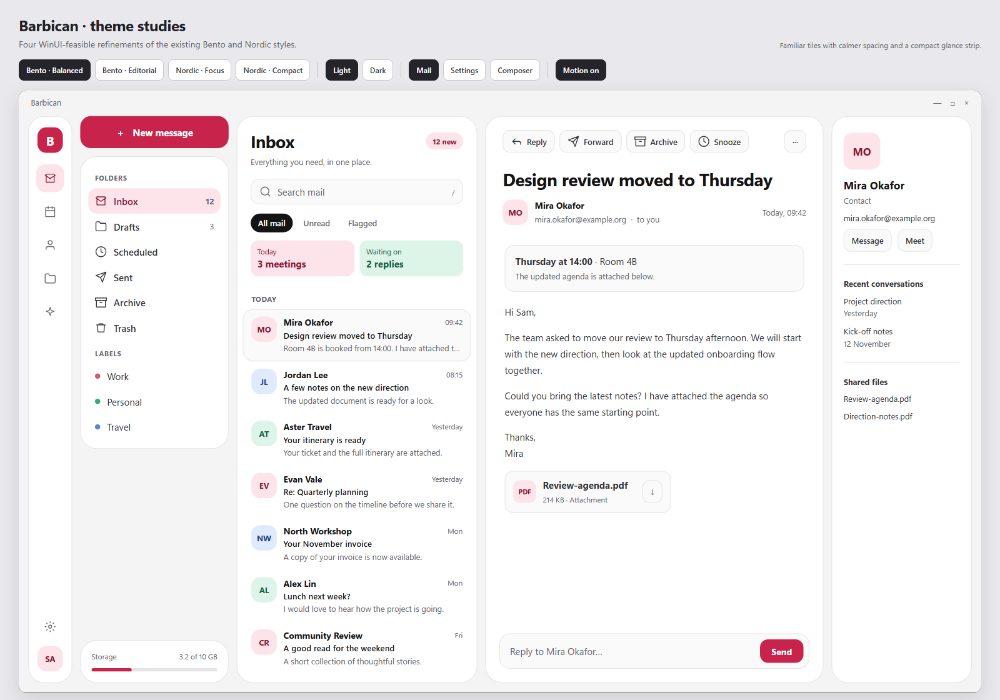
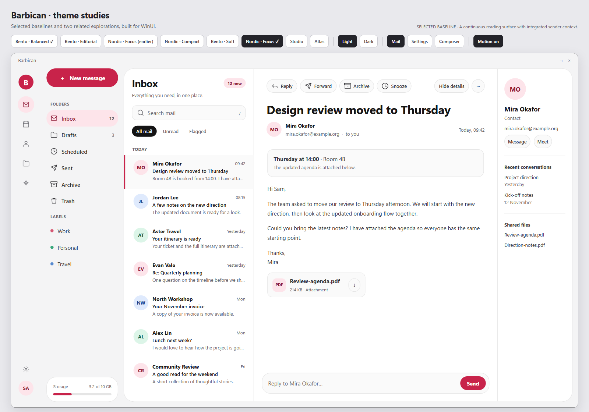

# Current UI guidelines

Approved by the user on 2026-11-19. Design studies by Codex / Terra High; direction recorded by the Sol coordinator.

The selected directions are **Bento Balanced** and **Nordic Focus**. Use these as the UI guidelines from now on, including work by Claude and future Codex agents. They refine the existing two styles; they do not add two more production styles. Where the older design boards differ, these directions take precedence. Preserve established functionality, accessibility and safety rules while applying the selected visual language.

## Bento Balanced

Keep separate rail, folder, message-list, reader and context tiles. Use calm spacing, clear sender/subject/preview hierarchy, restrained hairlines and consistent rounded corners. Retain the compact two-item glance strip and context panel when space allows. Keep the existing B mark, rose primary accent and semantic tints; avoid decorating every row with competing color.

Starting dimensions in effective pixels: 14 window inset, 12 tile gutters, 66 rail, approximately 208-222 folders, 345-360 list, 190-210 context, and a flexible reader. Tile corners are approximately 24-26. These are implementation starting points, not fixed widths at every text scale.

## Nordic Focus

Keep the rail and folders on the ground, with one continuous rounded list/reader/context surface separated by hairlines. Favor a spacious reading column and minimal chrome. Use pills/circles and the same B identity and palette. Nordic Focus includes the integrated sender/context panel selected by the user on 2026-11-19; keep the name Nordic Focus. The sender panel MUST be toggleable through an accessible show/hide control with a clear pressed state. Expand the reader when it is hidden, preserve the panel state when toggling, and provide keyboard access. Do not permanently reserve empty panel width.

Starting dimensions: 76 rail, approximately 210-228 folders, 330-350 list, flexible reader and about 190-210 for the context panel when open. Keep the existing shell breakpoints; collapse auxiliary context before compressing the reading area below roughly 420, with its show/hide control still accessible. At narrow widths use list/reader navigation rather than squeezing the entire desktop layout.

## Both styles and all screens

- Carry the selected language into Settings, Calendar, Contacts, Files, composer, dialogs and admin views. Support both light and dark modes with the shared palette. The checked-in light images illustrate geometry; use existing dark tokens for the corresponding dark treatment.
- Use Segoe UI Variable / Segoe UI, legible body and secondary type, consistent spacing, stable selection indicators and controlled wrapping. Respect text scaling, localization, keyboard focus, high contrast and reduced motion.
- Implement native chrome with existing WinUI 3 controls: Grid, Border, TextBlock, Button, PathIcon and virtualized ListView, plus the existing editor and mail-body host. Use shared brushes, StyleMetrics and StyleState. Do not hand-edit generated token output or introduce browser-only effects into native chrome.
- Follow [MOTION.md](MOTION.md): immediate state/focus/action updates; about 100 ms feedback and 150 ms entry decoration; exits instant or at most 90 ms; no animation over 200 ms; interrupt/retarget rather than queue; zero duration under reduced motion. Preserve incremental lists and avoid per-frame code-behind or refresh animations across every row.
- Existing popup, automation and account-safety rules remain mandatory. Use in-window selection/dialog patterns where required by ADR 0007.

These are approved design guidelines, not evidence that production controls already match them or that native accessibility/performance has passed. Record adoption and actual verification in milestone reports and the Codex/Astra implementation review log. Additional alternatives being explored by the same Terra agent remain proposals unless the user selects them.
